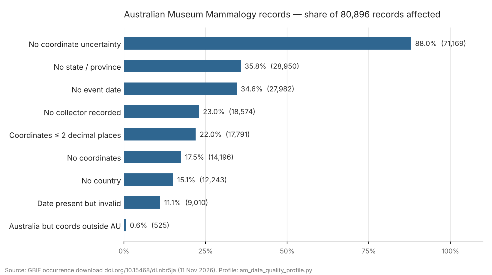

# Australian Museum Mammalogy records — data-quality check

I pulled the Australian Museum's Mammalogy occurrence records from GBIF (80,896 records, via OZCAM)
and ran a set of completeness and consistency checks over them, the kind of profiling I'd do before
any cleansing or migration work.

Data: GBIF.org (11 November 2026) Occurrence Download https://doi.org/10.15468/dl.nbr5ja
Raw data isn't included here; download it from the DOI.

## What came out



| Check | Records | % |
|---|---:|---:|
| No event date | 27,982 | 34.6% |
| No coordinates | 14,196 | 17.5% |
| No coordinate uncertainty | 71,169 | 88.0% |
| Coordinates with 2 or fewer decimal places | 17,791 | 22.0% |
| No state/province | 28,950 | 35.8% |
| No country | 12,243 | 15.1% |
| No collector recorded | 18,574 | 23.0% |
| Event date present but not a valid date | 9,010 | 11.1% |
| Country = Australia, coordinates outside Australia | 525 | 0.6% |
| Distinct catalogue-number patterns | 19 | |
| Duplicate catalogue numbers | 0 | 0.0% |

GBIF's own flags line up with this: 172 COUNTRY_COORDINATE_MISMATCH, 17 PRESUMED_NEGATED_LATITUDE,
26 RECORDED_DATE_INVALID, 14 RECORDED_DATE_UNLIKELY, 1 ZERO_COORDINATE.

`locality` is empty for every record, which almost certainly means it isn't published to GBIF
(locality data for specimens is often withheld), not that it's missing in the source system.

The 19 catalogue-number patterns are mostly `M.12345` vs `M.12345.001` style variations, which may
well be a legitimate specimen / sub-specimen convention. I'd want to check that against the
Museum's numbering standard before calling any of them errors.

Full output: [am_report.md](am_report.md)

## Where I'd start if I were fixing it

1. The 525 Australia-but-outside-Australia records. Most will be a dropped minus sign or swapped lat/lon and can be fixed in bulk once confirmed.
2. The 9,010 malformed dates. Keep them as partial dates with a precision flag rather than blanking them.
3. Coordinate uncertainty. 88% missing makes the coordinates hard to use; back-fill where the georeferencing method is known.
4. Re-run this script after each batch so the improvement is measurable.

## Running it

```
pip install pandas tabulate
python am_data_quality_profile.py occurrence.txt --out am_report.md
```
